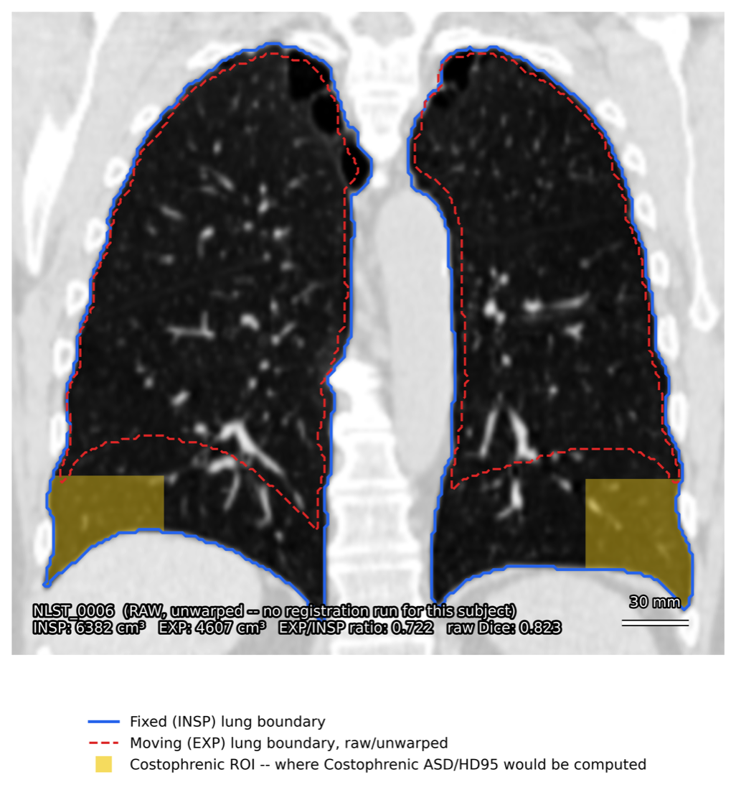
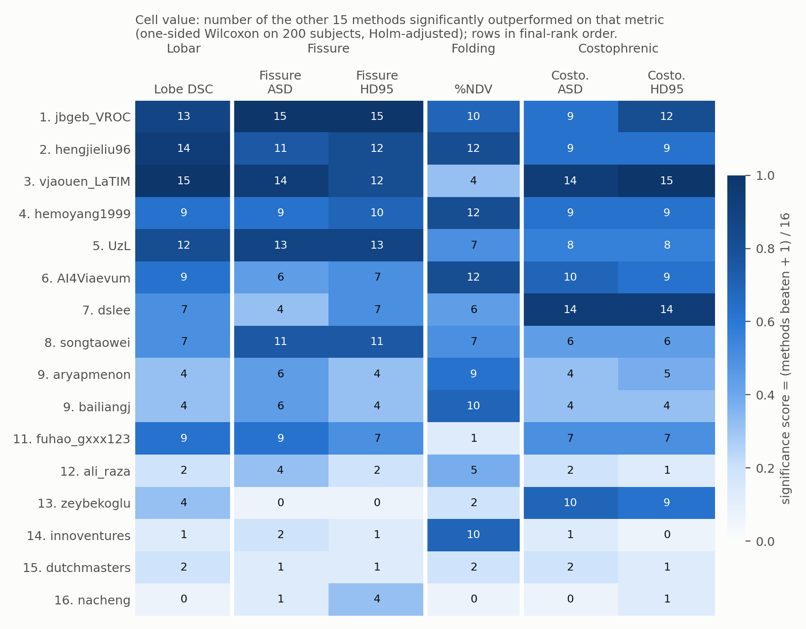
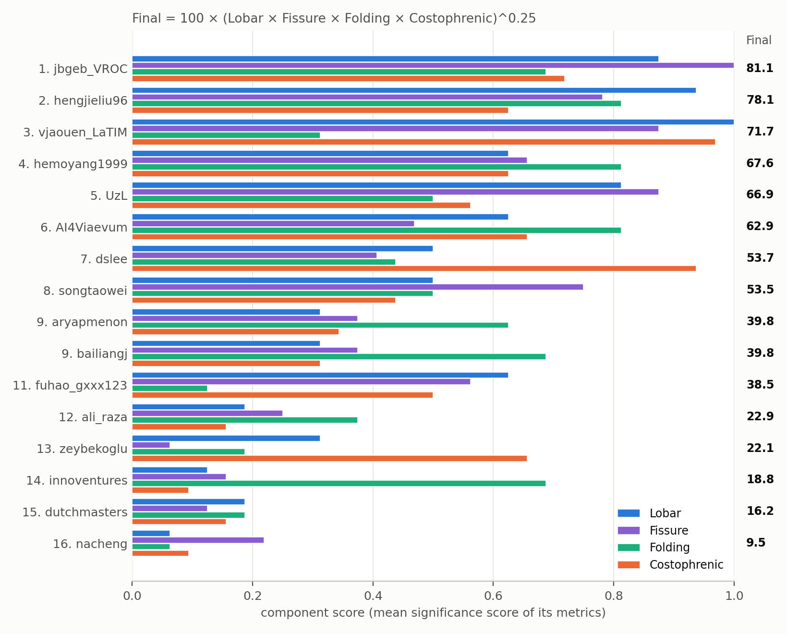
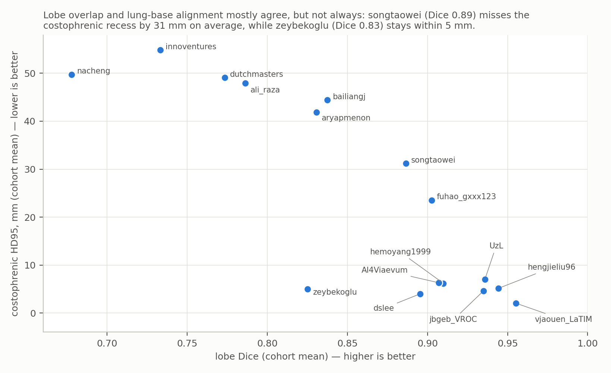
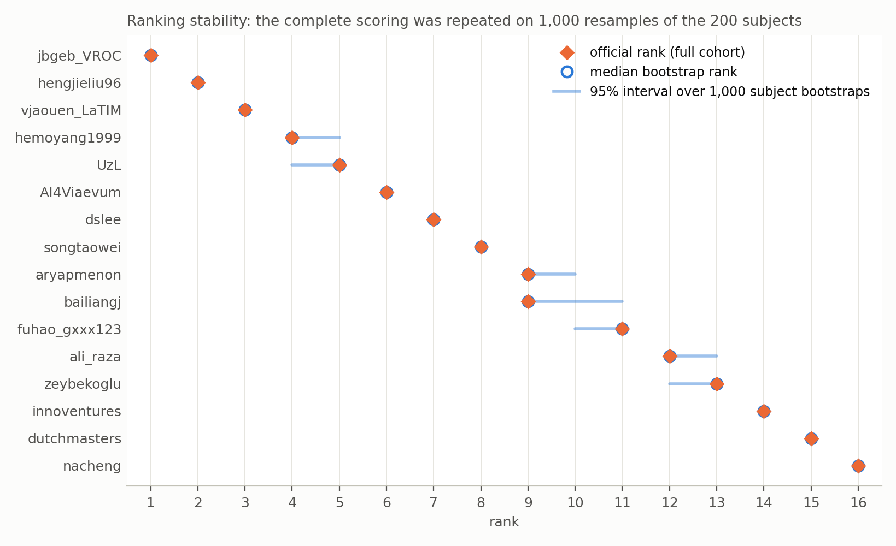

# Learn2Breath (Learn2Reg 2026) — Test-Phase Results

*Official results, released 2026-10-16.*

*The task: register the expiration CT (EXP, moving) onto the inspiration CT (INSP, fixed) of the same patient. The lungs shrink substantially on expiration, and the lung base moves most. Shown for an unregistered validation pair: fixed lung boundary in blue, moving boundary dashed red, and the costophrenic regions where the lung-base metrics are measured in yellow.*

## Test set

Hidden cohort from COPDGene: **200 subjects = 200 INSP/EXP registration pairs**, resampled to the shared 224 × 192 × 224 grid at 1.5 mm isotropic spacing. Submitted containers were run by the organizers.

## Metrics

Six metrics in four components, each computed per subject (200 values per method):

- **Lobar** — mean Dice over the five lung lobes, warped moving vs. fixed.
- **Fissure** — average surface distance (ASD) and 95th-percentile Hausdorff distance (HD95) between the warped moving and fixed fissure masks.
- **Folding** — % non-diffeomorphic volume of the displacement field inside the fixed lung mask (Liu et al. 2024). Values up to 0.005 % (≈ 480 voxels, ≈ 1.6 cm³) count as equivalent to no folding: each subject's value is reduced by 0.005 % and floored at 0.
- **Costophrenic** — ASD and HD95 between the warped moving and fixed lung boundaries, restricted to the costophrenic recess (the caudal 25 % × lateral 40 % of each lung), averaged over both sides. This is where breathing motion is largest and where lobe Dice is least sensitive to misalignment.

## How the ranking works

The ranking is *significance based*. A method earns credit on a metric only when it is **statistically significantly better** than another method across the 200 subjects; a slightly higher mean earns nothing. This makes metrics with different units (Dice, millimetres, percent) combinable without arbitrary normalisation, and makes the ranking insensitive to outlier subjects.

**Step 1 — pairwise tests per metric.** For each of the six metrics, every ordered pair of methods (A, B) is compared with a one-sided Wilcoxon signed-rank test on the 200 paired subject-level values. The *p*-values of all K(K−1) = 240 comparisons for a metric are Holm-adjusted together. A "significantly outperforms" B when the adjusted one-sided *p* < 0.05.

**Step 2 — significance scores.** A method's score on a metric is (number of methods it significantly outperforms + 1) / K, with K = 16. It ranges from 1/16 (beats nobody) to 1 (beats everybody). The figure below shows, for every method and metric, how many of the other 15 methods it beat.

Reading the figure: the winner, **jbgeb_VROC**, beats all 15 other methods on both fissure metrics and 13 on lobe Dice. It is not the best on any other single metric, but it has no weak component. **hengjieliu96** is second best on lobe Dice (14 beaten) and among the best on folding (12). **vjaouen_LaTIM** has the best lobe Dice in the field (all 15 beaten) and the best costophrenic alignment (14 and 15 beaten), but beats only 4 methods on folding (mean %NDV 0.19 %), which holds it to 3rd. **dslee** is the mirror image of the fissure specialists: second-best lung-base alignment (14 and 14) with mid-table fissure and lobe scores. **zeybekoglu** aligns the lung base well (10 and 9) but beats nobody on the fissures. **innoventures** folds very little (10 beaten) but ranks near the bottom on every accuracy metric.

**Step 3 — component scores and the final score.** Lobar is the lobe-Dice score. Fissure is the mean of its two metric scores, Folding is the %NDV score, and Costophrenic is the mean of its two metric scores. The final score is an equally weighted geometric mean, Final = 100 × (Lobar × Fissure × Folding × Costophrenic)^0.25, so a method cannot compensate for a very poor component with an excellent one.

Worked example, **hemoyang1999** (4th): beats 9 methods on lobe Dice → Lobar = 10/16 = 0.625. Beats 9 and 10 on fissure ASD/HD95 → Fissure = mean(10, 11)/16 = 0.656. Beats 12 on %NDV → Folding = 13/16 = 0.813. Beats 9 and 9 on costophrenic ASD/HD95 → Costophrenic = 10/16 = 0.625. Final = 100 × (0.625 × 0.656 × 0.813 × 0.625)^0.25 = 67.6.

The costophrenic component is there because lobe overlap alone does not show whether the lung base is aligned:

**Step 4 — how certain is the order?** The complete procedure (tests, Holm adjustment, final score) was repeated on 1,000 bootstrap resamples of the 200 subjects, using the same resample for every method. Places 1, 2 and 3 are certain: each of those teams holds its place in every resample. So are places 6–8 and 14–16. Only three groups overlap: places 4–5 (hemoyang1999, UzL), 9–11 (aryapmenon, bailiangj, fuhao_gxxx123) and 12–13 (ali_raza, zeybekoglu). Within those groups, the order is within the sampling uncertainty of a 200-subject cohort and should not be over-interpreted.

## Final ranking (K = 16)

The table lists the 16 participating teams. The descriptive columns are cohort means over the 200 subjects (%NDV before the 0.005 % adjustment). aryapmenon and bailiangj have identical final scores and share 9th place.

| # | Team | Final score | Rank 95% CI | Lobe DSC | Fissure ASD (mm) | Fissure HD95 (mm) | %NDV | Costo. ASD (mm) | Costo. HD95 (mm) |
|---:|---|---:|:---:|---:|---:|---:|---:|---:|---:|
| 1 | jbgeb_VROC | 81.1 | 1–1 | 0.935 | 1.92 | 8.9 | 0.0058 | 1.16 | 4.6 |
| 2 | hengjieliu96 | 78.1 | 2–2 | 0.944 | 3.02 | 13.3 | 0.0000 | 1.04 | 5.1 |
| 3 | vjaouen_LaTIM | 71.7 | 3–3 | 0.955 | 2.29 | 12.5 | 0.1907 | 0.36 | 2.0 |
| 4 | hemoyang1999 | 67.6 | 4–5 | 0.910 | 5.23 | 18.6 | 0.0000 | 1.18 | 6.2 |
| 5 | UzL | 66.9 | 4–5 | 0.936 | 2.57 | 11.7 | 0.0310 | 1.72 | 7.0 |
| 6 | AI4Viaevum | 62.9 | 6–6 | 0.907 | 6.89 | 21.1 | 0.0001 | 1.06 | 6.3 |
| 7 | dslee | 53.7 | 7–7 | 0.895 | 8.66 | 22.7 | 0.0510 | 0.64 | 4.0 |
| 8 | songtaowei | 53.5 | 8–8 | 0.886 | 2.91 | 14.5 | 0.0475 | 9.57 | 31.2 |
| 9 | aryapmenon | 39.8 | 9–10 | 0.831 | 7.56 | 29.5 | 0.0131 | 12.03 | 41.9 |
| 9 | bailiangj | 39.8 | 9–11 | 0.838 | 7.54 | 29.4 | 0.0026 | 12.62 | 44.4 |
| 11 | fuhao_gxxx123 | 38.5 | 10–11 | 0.903 | 5.44 | 22.9 | 2.5949 | 5.29 | 23.5 |
| 12 | ali_raza | 22.9 | 12–13 | 0.786 | 8.53 | 31.5 | 0.0959 | 14.02 | 47.9 |
| 13 | zeybekoglu | 22.1 | 12–13 | 0.825 | 13.38 | 47.4 | 0.2874 | 0.96 | 5.0 |
| 14 | innoventures | 18.8 | 14–14 | 0.733 | 10.85 | 34.5 | 0.0022 | 19.49 | 54.9 |
| 15 | dutchmasters | 16.2 | 15–15 | 0.773 | 11.62 | 32.9 | 0.3241 | 14.58 | 49.1 |
| 16 | nacheng | 9.5 | 16–16 | 0.678 | 11.17 | 29.1 | 7.1449 | 20.67 | 49.8 |

## Notes

- When the costophrenic distance is undefined for one lung side of a subject, that side receives a fixed penalty (ASD 35.53 mm, HD95 102.08 mm). This accounts for every costophrenic HD95 above 100 mm in the data (19 subject values across 6 teams). Because the ranking uses rank-based tests, these values affect it less than they affect the cohort means in the table.
- For questions about individual results, contact the organizers.

## Files in this folder

- `ranking_table.csv` — the ranking table above, with bootstrap rank intervals, per-metric significance scores, component scores and cohort means.
- `figures/` — all figures. `figures/make_ranking_figures.py` regenerates the four ranking figures from `ranking_table.csv`.
